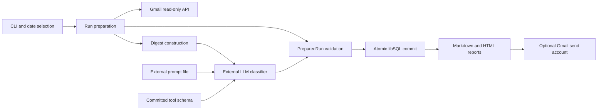
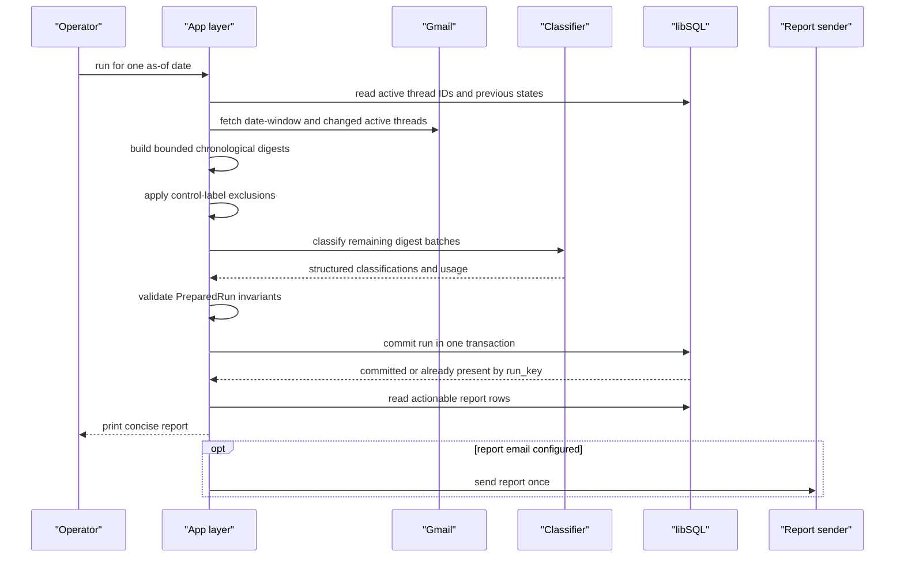

# Architecture

QuoteWatch keeps orchestration, domain validation, integrations, reporting, and
storage separate. The binary is intentionally thin; the app layer owns the run
sequence and delegates provider-specific and persistence details.

## Module boundaries

| Path | Responsibility |
| --- | --- |
| `src/app/` | CLI types, date resolution, Gmail export/replay, run preparation, orchestration, and optional report email flow |
| `src/domain/` | Gmail/thread data shapes, digest construction, workflow states, `PreparedRun`, and its invariants |
| `src/integrations/gmail/` | OAuth client/token handling, Gmail reads, parsing, control-label lookup, and optional report sending |
| `src/integrations/classifier/` | Provider request/response shapes, external prompt loading, tool-schema parsing, batch validation, costs, and deterministic guards |
| `src/integrations/http.rs` | Shared bounded retry behavior for Gmail, OAuth refresh, and classifier JSON requests; Gmail pacing, quota-error detection, and retry diagnostics live in `http/gmail.rs` |
| `src/storage/` | libSQL facade, migrations, database retry policy, atomic run commits, report reads, and encrypted token storage |
| `src/reporting/` | Concise/detailed Markdown and concise HTML rendering |
| `xtask/` | Local classifier-regression scenario runner |

Provider wire types remain inside the integration layer. The domain layer does
not depend on Fireworks or Anthropic response shapes, and the storage layer
accepts a validated domain object rather than classifier payloads.

## Run sequence

### Fetch and active refresh

The date query finds Gmail messages in the requested window and deduplicates
their thread IDs. Existing active threads that are absent from the date query are
also refreshed. For a live run they are re-fetched by ID; for an input-JSON
replay the last stored raw thread is used. An active thread is reclassified only
when its message-ID sequence changes or a recognized control label appears.

### Digest construction

Digests exclude messages after the run's as-of date, using an IST end-of-day
cutoff. They keep the last 14 eligible messages. Each body is cleaned at common
quoted-message/disclaimer boundaries and capped at 2,000 characters. Older
omitted messages contribute only small directional keyword counts. Attachment
filenames are retained, but attachment bodies are not fetched into the digest.

### Classification

The provider client loads `CLASSIFICATION_PROMPT_FILE` when it is constructed.
The structured-output schema remains compiled into the binary. Batches are
validated against the exact set of requested thread IDs before deterministic
guards run. If a multi-thread response is incomplete, the provider retries the
same digests individually and aggregates usage.

### Prepared state

`PreparedRun::validate` rejects empty accounts, duplicate inputs, duplicate
classifications, classifications without a matching input, thread-count
mismatches, and inconsistent previous/new states. Transition decisions are
prepared from the currently stored state, before the transaction starts.

### Atomic persistence and idempotency

The storage layer converts a `PreparedRun` into DB-ready rows before opening its
transaction. Within one transaction it:

1. checks for the deterministic `run_key`;
2. inserts the run and usage/cost fields;
3. upserts raw thread and digest JSON;
4. updates classification fields and expiry;
5. appends state transitions; and
6. commits or rolls back the whole attempt.

The `run_key` is derived from account, as-of date, optional label, and model.
Transaction retries therefore remain idempotent after an ambiguous remote
failure. A date range repeats this sequence independently for each date.

## State and retention

`QUOTATION_REPLY_PENDING` rows expire seven days after the run date that set the
state. `FOLLOWUP_PENDING` rows expire after fourteen days. `IGNORED` rows do not
receive an actionable expiry. Reports select only unexpired actionable rows.

Active-thread refresh uses the processing date: pending rows whose `expires_on`
is before that date are skipped. Rows expiring on that date, or with no expiry,
remain eligible. The same filter applies to live Gmail refresh and stored-input
replay. Expired rows remain in the database for history; a thread found in the
daily search can still be processed when new mail arrives. Backfills use their
processing date, independently of today's date or the latest stored run.

Control labels are read through `gmail.readonly` and never created or changed:

- `Ignore`
- `Order Received`
- `Order Closed`

## Deliberate side effects during preparation

CRM run/thread/transition state is not written before the commit. OAuth access is
a separate concern: when encrypted DB token storage is enabled, bootstrap or
refreshed Gmail tokens can be written while Gmail is accessed during preparation.
This distinction matters when diagnosing a failed run.
